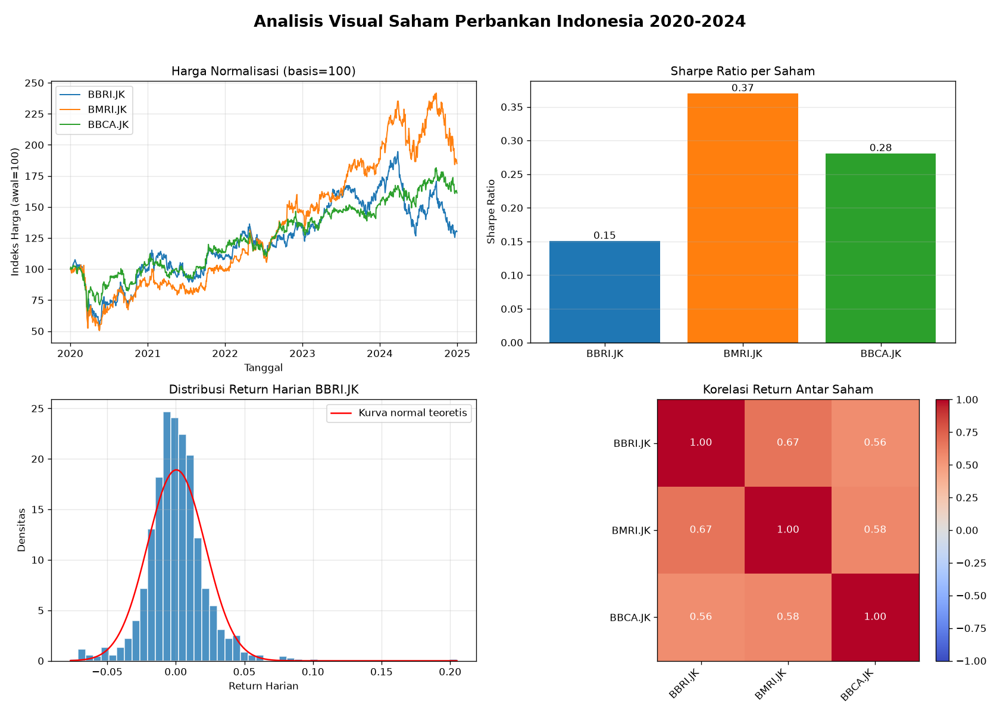

# 📊 Visual Analysis of Indonesian Banking Stocks

## 🎯 Project Description

This project created a visual report to compare the performance of BBRI, BMRI and BBCA banking shares during the 2020-2024 period using Python. The result is one image containing 4 charts: normalized price movements, Sharpe Ratio, daily return distribution, and correlation between stocks. The script also prints Skewness, Kurtosis, Sharpe Ratio, and correlation matrix values in the terminal.

## ❓ Questions Answered

- Which shares have had the highest price growth since the start of the period?
- Which stock is the most efficient (Sharpe Ratio)?
- Is the daily return normally distributed, or does it have a thick tail (Skewness and Kurtosis)?
- How strong is the correlation between stocks, and does combining them still provide diversification benefits?

## 🛠️ Tools & Library

- Python 3.10+
- pandas, numpy
- yfinance
- matplotlib

## 📁 Project Structure

```
idx-bank-stock-visual-report/
├── README.md
├── requirements.txt
├── main.py
└── output/
    └── visual_report_saham.png
```

## 🔍 How to Run

1. Clone this repository
   ```bash
   git clone https://github.com/username/idx-bank-stock-visual-report.git
   ```
2. Install library
   ```bash
   pip install -r requirements.txt
   ```
3. Run script
   ```bash
   python main.py
   ```
4. Open the image results at `output/visual_report_saham.png`

## 📈 Main Results

| Metrik | BBRI | BMRI | BBCA |
|---|---|---|---|
| Sharpe Ratio | 0.151 | 0.370 | 0.281 |
| Skewness | 0.920 | 0.214 | 1.040 |
| Kurtosis | 9.206 | 5.694 | 12.839 |

- **Correlation:** Returns for the three shares are correlated 0.56 - 0.67.
- **Conclusion:** During 2020-2024, BMRI shares had the highest Sharpe Ratio (0.370), while the return distribution showed a kurtosis of 5,694, which means BMRI can produce relatively more optimal returns and has a more controlled risk of crash compared to BBRI and BBCA.

> **Note:** If the message `[WARN]` appears when the program is running, it means that the download of yfinance failed and the program used **simulation data (not original data)**. Don't use these results for conclusions.

## 🖼️ Visualisasi



## ⚠️ Disclaimer

This project is educational and not an investment recommendation. Past performance does not guarantee future results.

## 👤 Author

Afif Ardian Saputra
